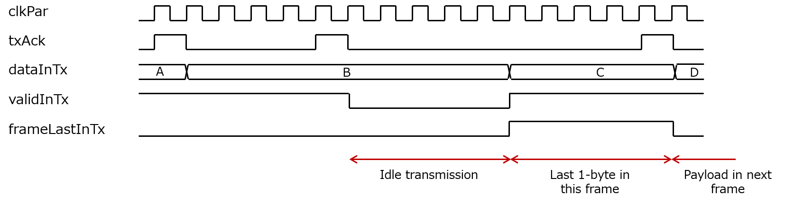
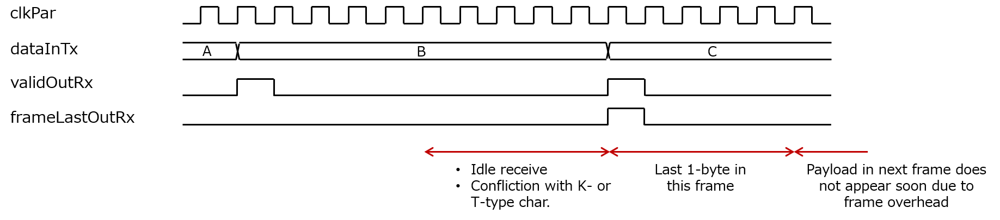
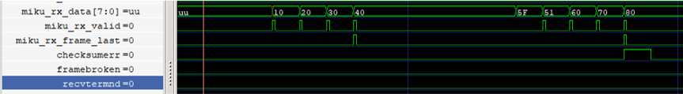
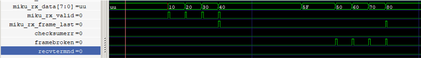
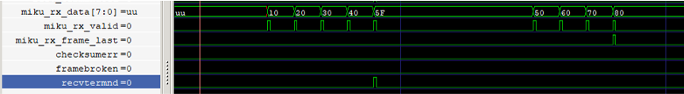

## MIKUMARI link protocol

The MIKUMARI link is a link layer protocol to establish the communication link between two end points, which are physically connected. The roles of the MIKUMARI link are as follows.

- Define the K-type characters; these are characters for the link control.
- Define a frame structure, called the MIKUMARI frame, for the data transmission
- One-shot pulse transmission with fixed latency using K-type characters.

### Interface of MIKUMARI link

**MikumariLane** is the top-level MIKUMARI link module. Protocol constants and pulse types are defined in `defMikumari.vhd`; CBT data types are defined in `defCDCM.vhd`.

#### Generics

| Generic | Description |
| --- | --- |
| `kNumEncodeBits` | CDCM payload bits per `clkPar` cycle: `1` for 1.5 modes; `2` for 2.5 modes. Match the CBT setting. |
| `enScrambler` | Enable the data scrambler and descrambler when `true`. |
| `kHighPrecision` | Select High-Precision pulse mode when `true`; Low-Latency mode when `false`. |
| `enDEBUG` | Enable the preset `mark_debug` attributes. |

#### System port

| Port | Direction | Description |
| --- | --- | --- |
| `srst` | In | Active-high reset for the MIKUMARI link. |
| `clkPar` | In | Parallel clock from BUFG. Use the same clock as the CBT. |
| `cbtUpIn` | In | CBT ready signal. Connect to `CbtLane.cbtLaneUp`. |
| `linkUp` | Out | High when the MIKUMARI link is established. |

#### TX port

| Port | Direction | Description |
| --- | --- | --- |
| `dataInTx` | In | 8-bit TX frame payload. |
| `validInTx` | In | High when `dataInTx` is valid. |
| `frameLastInTx` | In | High when `dataInTx` is the last byte of the frame payload. |
| `txAck` | Out | Acknowledges acceptance of valid TX data. |
| `pulseIn` | In | One-cycle pulse transmission request. Accepted when `busyPulseTx` is low. |
| `pulseTypeTx` | In | 3-bit pulse type, latched when `pulseIn` is accepted. |
| `pulseRegTx` | In | 4-bit extra pulse data, latched when `pulseIn` is accepted in High-Precision mode. |
| `busyPulseTx` | Out | High while a pulse is reserved or being transmitted; `pulseIn` is ignored. |
| `isKtypeOut` | Out | High when `cbtDataOut` is K-type. Connect to `CbtLane.isKTypeTx`. |
| `cbtDataOut` | Out | 8-bit data for the CBT. Connect to `CbtLane.dataInTx`. |
| `cbtValidOut` | Out | High when `cbtDataOut` is valid. Connect to `CbtLane.validInTx`. |
| `cbtTxAck` | In | CBT TX acknowledgement. Connect to `CbtLane.txAck`. |
| `cbtTxBeat` | In | CBT character transmission cycle indicator. Connect to `CbtLane.txBeat`. |

#### RX port

| Port | Direction | Description |
| --- | --- | --- |
| `dataOutRx` | Out | 8-bit RX frame payload. |
| `validOutRx` | Out | High when `dataOutRx` is valid. |
| `frameLastRx` | Out | High when `dataOutRx` is the last byte of the frame payload. |
| `checksumErr` | Out | Checksum mismatch in the received frame. |
| `frameBroken` | Out | Frame payload received without a frame start K-type character (FSK). |
| `recvTermnd` | Out | FSK received before the previous frame's frame end K-type character (FEK). |
| `pulseOut` | Out | Reproduced one-shot pulse. |
| `pulseTypeRx` | Out | Received 3-bit pulse type, valid when `pulseOut` is high. |
| `pulseRegRx` | Out | Received 4-bit extra pulse data, valid with `pulseOut` in High-Precision mode; zero in Low-Latency mode. |
| `isKtypeIn` | In | High when `cbtDataIn` is K-type. Connect to `CbtLane.isKTypeRx`. |
| `cbtDataIn` | In | 8-bit data from the CBT. Connect to `CbtLane.dataOutRx`. |
| `cbtValidIn` | In | High when `cbtDataIn` is valid. Connect to `CbtLane.validOutRx`. |

### MIKUMARI frame and data transmission

The MIKUMARI protocol transmits the data using a simple frame structure, called the MIKUMARI frame. The frame consists of four blocks as follows.

- Frame start K-type character (FSK)
- Arbitral length data body (payload)
- 8-bit checksum
- Frame end K-type character (FEK)

The frame structure is similar that of [Xilinx Aurora 8b/1b](https://japan.xilinx.com/products/intellectual-property/aurora8b10b.html) protocol. Inserting FSK, FEK, and checksum are done by the MIKUMARI link, and later two are inserted after detecting frameLastInTx. At the receiver side, frameLastOutRx assertion and checksum calculation are performed after detecting the FEK. **Note that 8-bit checksum data does not appear from dataOutRx. It is internally used.** About details of the frame structure, see also [Ref](https://ieeexplore.ieee.org/document/10098185).

Since the frame body and 8-bit checksum data are D-type character, their transmission request can be blocked by the T-type character transmission by the CBT. If it is blocked, the txAck is not returned at the expected timing, the upper layer protocol needs to keep the current dataInTx and validInTx until txAck is returned. It is defined that pulse K-type characters have higher priority to other K-type character in this protocol. Thus, FSK and FEK insertion can be delayed by pulse transmission request. Therefore, the data transmission latency using the MIKUMARI frame is not perfectly fixed. Use the pulse transfer function for usages where arrival times must be strictly controlled.

The data interface of the MIKUMARI link is also similar to that of [Xilinx Aurora 8b/1b](https://japan.xilinx.com/products/intellectual-property/aurora8b10b.html) protocol (AXI4-stream). As there is the CBT character transmission cycle, txAck signal is used instead of tready signal.

The time chart for MIKUMARI data transmission is shown in the [figure](#MIKU-TX-TIME). The upper layer protocol sets the next data after detecting txAck high. If the data is last 1-byte of the frame body, assert frameLastInTx and keep it high until the next txAck high. The data 'D' is the 1st 1-byte of the data body in the next frame. We can suspend the data transmission by de-asserting validInTx. If validInTx is low at the txBeat timing, idle character is sent.

{: #MIKU-TX-TIME width="100%"}

The time char for MIKUMARI data receive is shown in the [figure](#MIKU-RX-TIME). The validOutRx goes high when the dataOutRx is valid. If the dataOutRx is the last 1-byte of the frame, frameLastOutRx goes high at the same timing of validOutRx. After that, as checksum and K-type character receive continues, user data in the next frame will not appear immediately. Sometimes, validOutRx will not go high at the expected timing due to idle character receive or conflicting with K- or T-type characters.

{: #MIKU-RX-TIME width="100%"}

### Pulse transmission

From version 2.0, the MIKUMARI-link protocol supports the high-precision mode for the pulse transmission. The original mode is called the low-latency mode to distingush them.

**Low-latency mode**

The pulse transmission with pulse types is realized by using K-type characters. The pulse type and the transmission request timing are encoded to a K-type character, and it is transmitted with highest priority. The receiver side decodes the received pulse K-type character and reproduces the pulse timing and the pulse type value. While the CBT character transmission is accepted once per 5 or 10 clock cycles, the pulse transmission can be requested at any timing. Due to the internal process realizing this feature, an additional idle character transmission is necessary after the pulse K-type character transmission. Therefore, the busy length for a pulse transfer is 10 and 20 clock cycles for CDCM-10-2.5 (CDCM-8-2.5) and CDCM-10-1.5 (CDCM-8-1.5), respectively. This limits the maximum pulse frequency. In addition, transmission of several pulse types at the same timing is also impossible.

Due to the limitation of the range of expressible bit combinations using 8-bit, the pulse K-type characters do not guarantee the DC balance of the signal on the transmission line. If the averaged duty ratio of the CDCM modulated clock is not 50%, the recovered clock signal phase is systematically shifted depending on the averaged duty ratio. This effect is visible when the pulse transfer rate is high. See [Ref](https://ieeexplore.ieee.org/document/10098185) for the details.

**High-precision mode**

The 3-bit pulse type and the 4-bit extra data are encoded to **two K-type characters.** Thus, the pulse trasmission takes longer pulse transmission latency and the busy time than thoese of the low-latency mode. For the same reason, the miximu pulse transmission rate is also decreased.
Instead, the high-precision mode ensures the DC balance perfectly. The phase shift of the recovered clock signal seen in the low-latency mode will not happen. This mode provides the better clock signal synchronization.

The author expects to use the extra 4-bit data to send information for the finer timing comepensation. For example, you can implement the 1-ns 3-bit TDC measuring the input pulse timing in the primary side (clkPar frequency is expected to be 125 MHz), and the TDC value is sent to the secondary side. Thus, you achieve the 1-ns timing trasmission.

### Data scrambler

The MIKUMARI link supports the data scrambling based on PRBS16. Since the data scrambler guarantees the DC balance on average and there is no demerit, the author strongly recommend to use it.

### Checksum error

The checksumErr goes high, if the received checksum value and the calculated value is not the same. The MIKUMARI link do nothing even if the checksum error is detected. When the error is detected, error handring is left to the upper layer protocol. This signal indicates that the communication error for D-type characters happens.
If the checksum error happens, the checksumErr signal goes high at the same timing of the frameLastRX signal as shown in the [figure](#CHECKSUM-ERR).

{: #CHECKSUM-ERR width="100%"}

### Frame broken

The data frame of the MIKUMARI-link protocol is defined as the D-type characters sandwitched by FSK and FEK.
The frame broken signal goes high, if the D-type characters are received without detecting FSK.
Since the frame starting position is unknown, all the data in this frame are invalid.
The frame broken signal goes high instead of the validOutRx signal as shown in the [figure](#frame-broken).

{: #FRAME-BROKEN width="100%"}

### Receive terminated

The recvTernd signal represents taht the frame receive process is terminated.
This signal goes high if the FSK is received without detecting the FEK for the previous frame as shown in the [figure](#RECV-TERM).
Since the frame end position of the 1st frame in the [figure](#RECV-TERM), the frame receive is terminated and it restarts immediately.
Then, the 2nd frame in the [figure](#RECV-TERM) is valid.

{: #RECV-TERM width="100%"}
