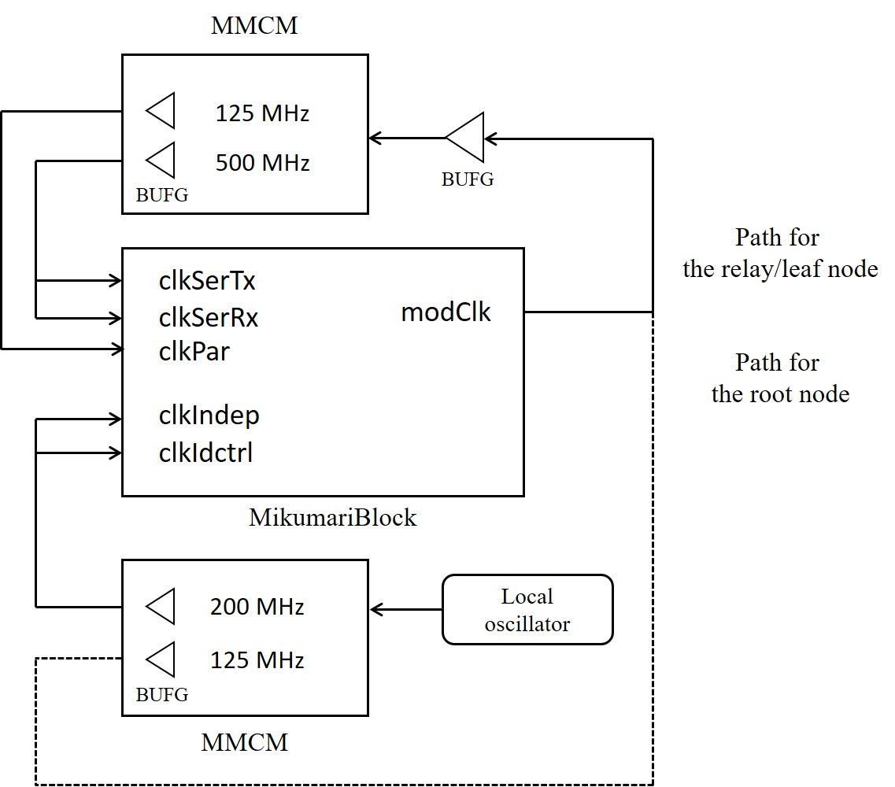
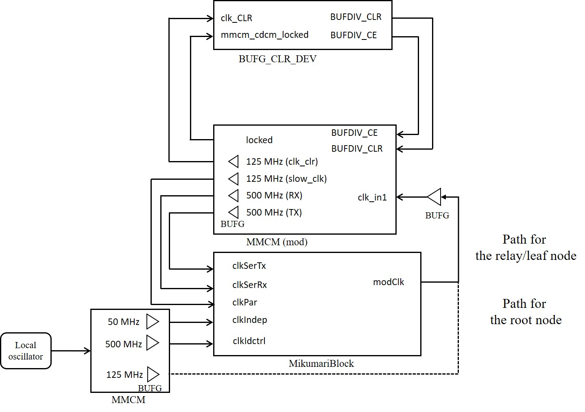
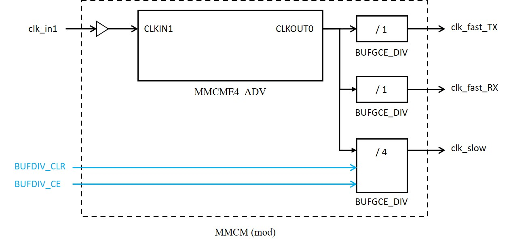
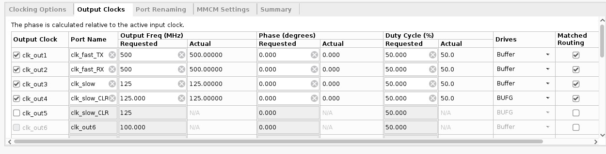
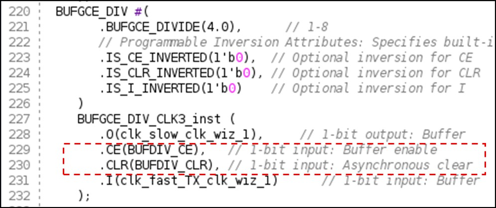
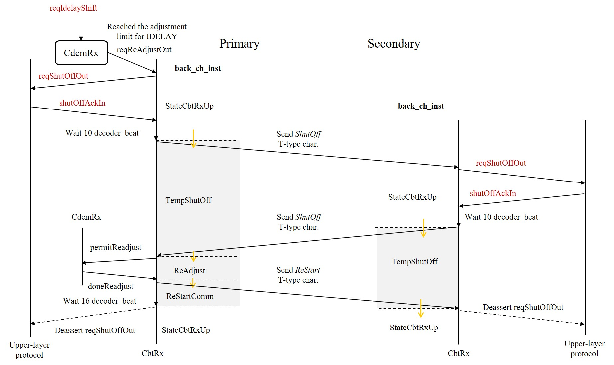

# Practical Usage

## MikumariBlock

The MikumariBlock is a wrapper module including the CbtLane and the MikumariLane. The intermediate signals between the CBT and the MIKUMARI link are hidden. For users, the author recommends to use the MikumariBlock. The almost all MikumariBlock entity ports are directly connected to the CBT and the MikumariLane entity ports. The reset asynchronous is available, finally input to the MikumariBlock is .

## Clock Configuration

This section provides an example of using the MIKUMARI modulated clock with a frequency of 125 MHz and the `CDCM-8-XX` modulation pattern.

### 7-series FPGAs

The [figure](#CLOCK-7series) shows an example of a clock configuration for a 7-series 7 FPGA. This example uses an MMCM for clock recovery, but the MMCM can also be replaced with an external PLL. The example shown assumes that the reference clock frequency transmitted via the MIKUMARI link is 125 MHz. `clkidctrl` must be set to 200 MHz. Do not select a `clkIndep` frequency that is an integer multiple (including 1) of clkPar. In the 7-series, `clkSerTx` and `Rx` can be clocked from the same source.

The MMCM includes a function to align the phases of the input and output clocks. As a result, clkPar can be obtained with a deterministic phase relationship relative to the modulated clock input `(modClk)`. Because of this characteristic, MMCMs generated from the IP catalog can be applied directly to 7-series FPGAs.

{: #CLOCK-7series width="60%"}

### UlstraScale FPGAs

With UltraScale FPGAs, using an MMCM generated from the IP catalog as-is does not minimize skew between multiple clock signals; therefore, a more complex clock configuration than that used with 7-series FPGAs is required. For details, refer to Xilinx `AR# 67885`.

The recommended clock configuration is shown in the [figure](#CLOCK-US). MMCM(mod) is a modified version of the MMCM generated from the IP catalog and has the internal structure shown in the [figure](#MMCM-MOD). In other words, `clkPar`, `clkSerTx`, and `clkSerRX` all originate from the same clock output, and `clkPar` is generated by dividing `clkSer` using `BUFGCE_DIV`. While this configuration minimizes skew between clocks, it introduces phase indeterminacy into `clkPar` due to the division process. Therefore, a clock signal phase-synchronized with the input modulation clock is generated separately `(clk_clr)`, and this clock is used to perform a synchronous reset of the divider counter, thereby obtaining a `clkPar` that is phase-synchronized with the input. These modified MMCM and `BUFG_CLR_DEV` files are included in the `support` directory.

Because the modified MMCM are used, constraints that automatically assigned by IP (such as `CLOCK_DELAY_GROUP` via *Matched Routing*) do not apply. Manually add the following constraint to the project's XDC:

```XDC
create_generated_clock -name clk_fast     [get_pins u_MMCM_CDCM/inst/mmcme4_adv_inst/CLKOUT0]
create_generated_clock -name clk_slow_CLR [get_pins u_MMCM_CDCM/inst/mmcme4_adv_inst/CLKOUT3]
create_generated_clock -name clk_slow     [get_pins u_MMCM_CDCM/inst/BUFGCE_DIV_CLK3_inst/O]

set_property CLOCK_DELAY_GROUP group_mmcm_cdcm_second [get_nets u_MMCM_CDCM/inst/clk_fast_TX]
set_property CLOCK_DELAY_GROUP group_mmcm_cdcm_second [get_nets u_MMCM_CDCM/inst/clk_fast_RX]
set_property CLOCK_DELAY_GROUP group_mmcm_cdcm_second [get_nets u_MMCM_CDCM/inst/clk_slow]
```

{: #CLOCK-US width="70%"}

{: #MMCM-MOD width="70%"}

#### Method for Producing Modified MMCM

- Generate MMCM from IP catalog: Check the *Optimize Clocking Structure* box on the Clocking Options page, and set output clocks as shown in the figure. Set `clk_slow_CLR` to the same values as clk_slow (125 MHz, phase 0&deg;). However, the actual phase of `clk_slow` is not determined until the CLR described below is applied. Set only `clk_slow_CLR` to `BUFG`; set the other three signals to `Buffer`. Check the *Matched Routing* box for all four signals. Additionally, since changing the order will alter the generated circuit, configure the four signals in the order shown in the figure.

{: #OUTPUT-CLOCKS width="100%"}

- Editing the Output Codes: Copy the two files generated by the IP (the wrapper file `<IP name>.v` and the main file `<IP name>_clk_wiz.v`), save them under different filenames, and use the edited code. Although `CE` and `CLR` are originally connected to fixed values, connect `BUFDIV_CE` and `BUFDIV_CLR` to them, respectively. Also, add the input ports for `BUFDIV_CE` and `BUFDIV_CLR` to both files.

{: #EDITING-MMCM width="60%"}

## Dynamic Re-alignment of Clock and Data Phases

When using long optical fibers-typically around 1 km-it is necessary to address phase shifts between the clock and data caused by changes in ambient temperature. In the primary node of MIKUMARI link, the modulated clock signal returned from the secondary node is sampled using the primary node's own transmission clock. In this process, the phase between the clock and data is affected by changes in transmission delay caused by the fiber's expansion and contraction. In such use cases, the MIKUMARI link's upper-layer protocol must measure the phase between the clock and data, and if the variation exceeds a certain threshold, the IDELAY tap value must be readjusted. If the system is operated without readjustment, data sampling becomes unstable as the phase variation approaches the unit interval, eventually causing the link to go down. The temperature coefficient of SMF-28, a common optical fiber material, is 35 ps/km/K [1]. Based on this value and the environment in which you plan to use MIKUMARI link, please determine whether a readjustment mechanism is necessary.

 [1] Slavík, R., et al., Sci Rep 5, 15447 (2015).

The current MIKUMARI link protocol provides the following signal ports for dynamic readjustment of the phase relationship:

- `reqIdelayShift`: A signal received from the upper-layer protocol to shift the IDELAY tap value by &plusmn;1. Entering "01" or "10" allows the tap value to be dynamically increased or decreased. This input must be a one-shot relative to `clkPar`.
- `reqShutOffOut`: This signal indicates that communication must be temporarily halted to perform a readjustment involving a change in bit positions when `IDELAY` is about to exceed its adjustable range. This request is a signal sent by the MIKUMARI link to the upper-layer protocol.
- `shutOffAckIn`: An input signal indicating that the upper-layer protocol has received a request from the link and has temporarily halted data communication.

The [figure](#READJUST-CBT) below shows a flowchart of the procedures for ensuring stable communication during long-distance transmission using these signals.
First, prepare some upper-layer protocol for measuring phase variations. For example, the use of a DDMTD-based [ClockPhaseAnalyzer](https://github.com/kpro-j2/ClockPhaseAnalyzer) can be considered.
The upper-layer protocol drives the `reqIdelayShift` signal as appropriate to adjust the tap values according to the phase variation. For example, when using IDELAYE2, this signal must be driven every 78 ps. At this time, it is strongly recommended to introduce hysteresis. When `reqIdelayShift` is received, the CBT adjusts the IDELAY settings immediately without halting the data communication.

{: #READJUST-CBT width="100%"}

After issuing `reqIdelayShift` multiple times, if the phase deviation appears likely to exceed the range adjustable by IDELAY, the CBT issues `reqShutOffOut`. This signal indicates that the CBT wishes to realign the phase relationship, which involves changing bit positions. Since this process may corrupt data, communication must be temporarily halted to perform the realignment. When this signal becomes `1`, the upper-layer protocol stops data communication at an appropriate time and then returns `shutOffAckIn`. This procedure must also be performed on the secondary node side. When the CBT completes the phase realignment, `reqShutOffOut` returns to `0`. At that point, the upper-layer protocol resets `shutOffAckIn` to `0` and resumes communication.

This procedure is completed within 1 ms. The decision regarding when to halt communication after `reqShutOffOut` becomes `1` is left entirely to the upper-layer protocol. Since phase variations due to temperature changes are assumed to be gradual, there should be ample time to respond.
